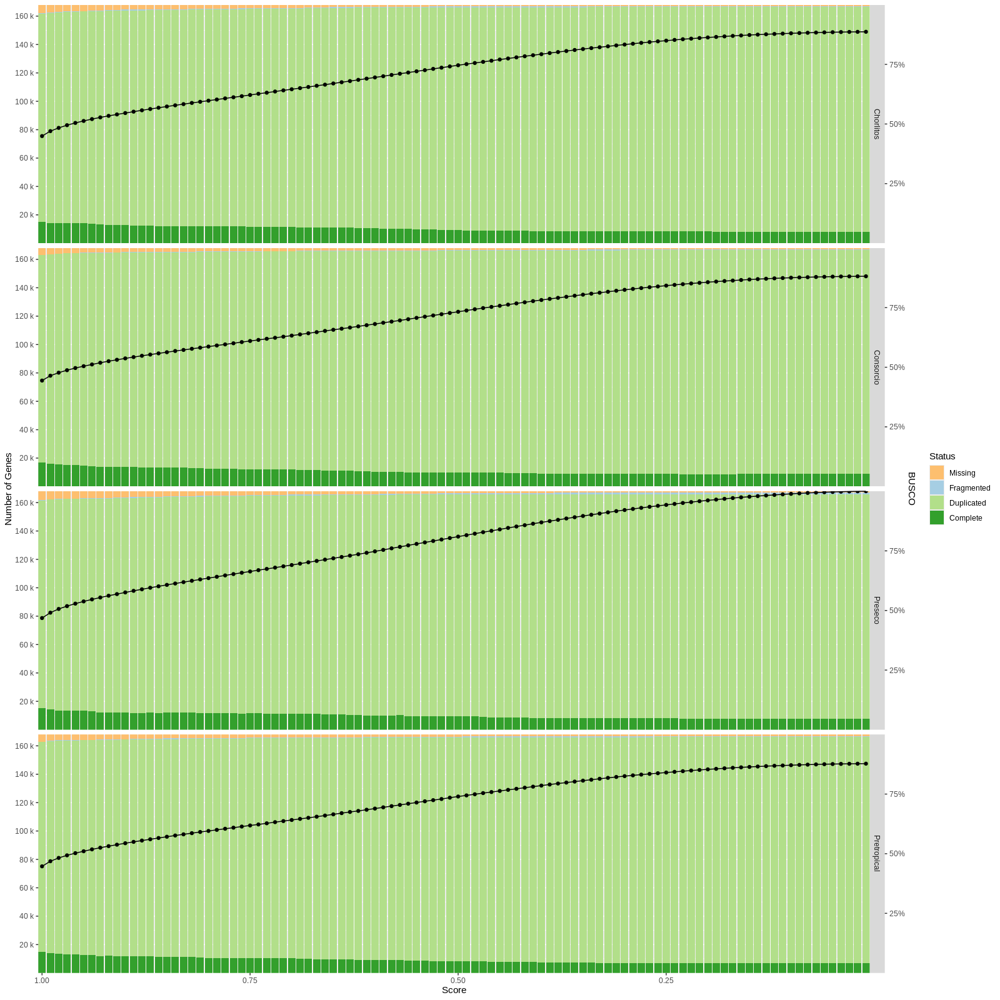

#+title: Readme
#+PROPERTY:  header-args :var DIR=(file-name-directory buffer-file-name)

** CODE
*** Run EDTA Raw
#+header: :var genomes=../0-ref/readme.org:genomes[,0]
#+begin_src shell :tangle 1-edta-raw/run.sh
ROOT=$(git rev-parse --show-toplevel)

# SET type using `--export=type=[ltr|tir|helitron|line|sine]`
name=${genomes[$SLURM_ARRAY_TASK_ID]}

ml apptainer

EDTA_raw () {
    singularity exec --no-home \
        --env=BLAST_USAGE_REPORT=false \
        -B /usr/bin/which -B $ROOT -B $TMPDIR \
        $ROOT/apps/EDTA-2.2.2.sif EDTA_raw.pl "$@"
}

zcat $ROOT/1-orient/4-genomes/$name.fa.gz > $TMPDIR/$name.fa

cd $TMPDIR

EDTA_raw --genome $TMPDIR/$name.fa \
    --species others \
    --type $type \
    --threads $SLURM_CPUS_PER_TASK

tar -vcf $DIR/1-edta-raw/$name.$type.tar $name.fa.mod*
#+end_src

#+RESULTS:

*** Combine EDTA
#+header: :var genomes=../0-ref/readme.org:genomes[,0]
#+begin_src shell :tangle 2-edta/run.sh
ROOT=$(git rev-parse --show-toplevel)
name=${genomes[$SLURM_ARRAY_TASK_ID]}

ml apptainer

EDTA () {
    singularity exec --no-home \
        --env=BLAST_USAGE_REPORT=false \
        -B /usr/bin/which -B $ROOT -B $TMPDIR \
        $ROOT/apps/EDTA-2.2.2.sif EDTA.pl "$@"
}

zcat $ROOT/1-orient/4-genomes/$name.fa.gz > $TMPDIR/$name.fa
for type in ltr tir helitron line sine; do
    tar -C $TMPDIR -xf $DIR/1-edta-raw/$name.$type.tar
done

cd $TMPDIR

EDTA --genome $TMPDIR/$name.fa \
    --overwrite 0 \
    --sensitive 1 \
    --anno 0 \
    --evaluate 0 \
    --threads $SLURM_CPUS_PER_TASK

tar -vcf $DIR/2-edta/$name.tar $name.fa.mod*
#+end_src
*** RepeatMasker
#+header: :var genomes=../0-ref/readme.org:genomes[,0]
#+begin_src sh :tangle 3-repeatmasker/run.sh
ROOT=$(git rev-parse --show-toplevel)
name=${genomes[$SLURM_ARRAY_TASK_ID]}

ml apptainer

RepeatMasker () {
    singularity exec --no-home \
        --env=BLAST_USAGE_REPORT=false \
        -B /usr/bin/which -B $ROOT -B $TMPDIR \
        $ROOT/apps/EDTA-2.2.2.sif RepeatMasker "$@"
}

tar -C $TMPDIR -xf $DIR/2-edta/$name.tar \
    $name.fa.mod.EDTA.TElib.fa
zcat $ROOT/1-orient/4-genomes/$name.fa.gz \
    >$TMPDIR/$name.fa

RepeatMasker -e ncbi -pa $SLURM_CPUS_PER_TASK \
    -q -div 40 -cutoff 225 -gff \
    -lib $TMPDIR/$name.fa.mod.EDTA.TElib.fa \
    $TMPDIR/$name.fa

perl -i -nle 's/\s+DNA\s+/\tDNA\/unknown\t/; print $_' \
    $TMPDIR/$name.fa.out

rm $TMPDIR/$name.fa.mod.EDTA.TElib.fa* \
    $TMPDIR/$name.fa

tar -vcf $DIR/3-repeatmasker/$name.tar \
    -C $TMPDIR \
    --transform 's:^\./::' \
    --show-transformed-names \
    .
#+end_src

*** Run braker3
#+header: :var genomes=../0-ref/readme.org:genomes[,0]
#+begin_src sh :tangle 4-braker3/run.sh
ROOT=$(git rev-parse --show-toplevel)
name=${genomes[$SLURM_ARRAY_TASK_ID]}

ml apptainer  bedtools/2.31.1

mkdir $TMPDIR/home
cp $HOME/.gm_key $TMPDIR/home

zcat $ROOT/0-ref/Viridiplantae.fa.gz > $TMPDIR/Viridiplantae.fa
zcat $ROOT/1-orient/4-genomes/$name.fa.gz > $TMPDIR/$name.fa
tar -Oxf $DIR/3-repeatmasker/$name.tar \
    $name.fa.out.gff > $TMPDIR/$name.repeats.gff3

bedtools maskfasta -soft \
    -fi  $TMPDIR/$name.fa \
    -bed $TMPDIR/$name.repeats.gff3 \
    -fo  $TMPDIR/$name.mask.fa

cd $TMPDIR

singularity exec --cleanenv -H $TMPDIR/home \
    -B $DIR -B $TMPDIR \
    $ROOT/apps/braker3-v3.0.7.6.sif \
    cp -r /opt/Augustus/config $TMPDIR/
    
singularity exec --cleanenv -H $TMPDIR/home \
    -B $DIR -B $TMPDIR \
    -B $TMPDIR/config:/opt/Augustus/config \
    $ROOT/apps/braker3-v3.0.7.6.sif braker.pl \
    --species=$name \
    --softmasking \
    --genome=$TMPDIR/$name.mask.fa \
    --prot_seq=$TMPDIR/Viridiplantae.fa \
    --threads=$SLURM_CPUS_PER_TASK \
    --workingdir=$TMPDIR 

rm $TMPDIR/$name.fa
rm $TMPDIR/$name.mask.fa
rm $TMPDIR/$name.repeats.gff3
rm $TMPDIR/Viridiplantae.fa

tar -vcf $DIR/4-braker3/$name.tar \
    -C $TMPDIR \
    --transform 's:^\./::' \
    --show-transformed-names \
    .
#+end_src

*** Add braker CDS to EDTA run
#+header: :var genomes=../0-ref/readme.org:genomes[,0]
#+begin_src shell :tangle 5-add-cds/run.sh
ROOT=$(git rev-parse --show-toplevel)

ml apptainer
EDTA () {
    singularity exec --no-home \
        --env=BLAST_USAGE_REPORT=false \
        -B /usr/bin/which -B $ROOT -B $TMPDIR \
        $ROOT/apps/EDTA-2.2.2.sif EDTA.pl "$@"
}

name=${genomes[$SLURM_ARRAY_TASK_ID]}

tar -C $TMPDIR/ -xf $DIR/2-edta/$name.tar
tar -C $TMPDIR -xf $DIR/4-braker3/$name.tar \
    braker.codingseq
zcat $ROOT/1-orient/4-genomes/$name.fa.gz > $TMPDIR/$name.fa

cd $TMPDIR
EDTA --genome $TMPDIR/$name.fa \
     --cds $TMPDIR/braker.codingseq \
     --sensitive 1 \
     --anno 1 \
     --evaluate 1 \
     --threads $SLURM_CPUS_PER_TASK

rm $TMPDIR/$name.fa
rm $TMPDIR/braker.codingseq

tar -C $TMPDIR --transform 's#^./##' \
    -cf $DIR/5-add-cds/$name.tar .
#+end_src

**** LAI
#+header: :var genomes=../0-ref/readme.org:genomes[,0]
#+begin_src sh :tangle lai.run.sh
ROOT=$(git rev-parse --show-toplevel)
name=${genomes[$SLURM_ARRAY_TASK_ID]}

ml apptainer
EDTA_run () {
    singularity exec --no-home \
        --env=BLAST_USAGE_REPORT=false \
        -B /usr/bin/which -B $ROOT -B $TMPDIR \
        $ROOT/apps/EDTA-2.2.2.sif "$@"
}

export ROOT DIR
export -f EDTA_run

zcat $ROOT/1-orient/4-genomes/$name.fa.gz \
    > $TMPDIR/$name.fa

tar -Oxf $DIR/5-add-cds/$name.tar \
    $name.fa.mod.EDTA.TEanno.gff3  |
    EDTA_run perl  /usr/local/share/EDTA/bin/gff2bed.pl \
        - structural \
        > $TMPDIR/$name.bed

grep LTR $TMPDIR/$name.bed |
    grep struc |
    awk '{print $1 ":" $2 ".." $3 "\t" $7}' \
        > $TMPDIR/$name.pass.list

awk '{ print 10000, 0.001, 0.001, 0.001, $1,
             $2, $3, "NA", $9, $4, $13 }' \
    $TMPDIR/$name.bed > $TMPDIR/$name.out

cd $TMPDIR
EDTA_run LAI -q -t $SLURM_CPUS_PER_TASK \
    -genome $TMPDIR/$name.fa \
    -intact $TMPDIR/$name.pass.list \
    -all $TMPDIR/$name.out

cat $TMPDIR/$name.out.LAI | gzip > $DIR/$name.LAI.gz
#+end_src

#+header: :dir (symbol-value 'ssh-deploy-root-remote)
#+header: :var ROOT=(file-local-name ssh-deploy-root-remote)
#+header: :var genomes=../0-ref/readme.org:genomes[,0]
#+begin_src shell :colnames '("Genome" "Length" "Raw.LAI" "LAI")
DIR=$ROOT/2-first-pass          #
for name in "${genomes[@]}"; do
    zcat $DIR/$name.LAI.gz |
    sed -n "s/whole_genome/$name/p" |
    cut -f 1,3,6,7
done
#+end_src

#+RESULTS:
| Genome      |     Length | Raw.LAI |   LAI |
|-------------+------------+---------+-------|
| Chorlitos   | 2300094691 |   13.41 | 15.45 |
| Consorcio   | 2295940108 |   13.52 | 16.91 |
| Preseco     | 2299273275 |   13.71 | 15.88 |
| Pretropical | 2298689817 |   13.36 | 16.08 |

#+header: :results graphics output file
#+header: :file LAI-distro.pdf
#+header: :width 12 :height 20 ::bg white
#+begin_src R :session
library(tidyverse)

genomes <- c("Chorlitos", "Preseco", "Consorcio",  "Pretropical")

lai.plots <- paste(genomes, 'LAI', 'gz', sep='.') %>%
  setNames(nm=genomes) %>%
  lapply(data.table::fread, header=F,
         col.names = c("Chr", "From",
                                       "To", "Intact", "Total",
                                       "raw.LAI", "LAI")) %>%
  bind_rows(.id="Genome") %>%
  filter(! Chr %in% c("Chr", "whole_genome")) %>%
  mutate(
         Genome = sub(".out.LAI", "", Genome),
         LAI = as.numeric(LAI),
         From = as.numeric(From)) %>%
  split(., .$Genome) %>%
  lapply(function(x){
    mutate(x,
           Chr = fct_inorder(factor(Chr)),
           color = ifelse(as.numeric(Chr)%%2, "ODD", "EVEN")) %>%
    ggplot() +
    geom_point(aes(From, LAI, color=color)) +
    scale_x_continuous(expand=c(0,0), name="Position") +
    scale_color_manual(values = c("grey40", "grey60")) +
    facet_wrap(vars(Chr), ncol=13,
               scales = 'free_x') +
    theme_minimal() +
    theme(panel.spacing = unit(1, "mm"),
          legend.position = 'none',
          panel.grid.major.x = element_blank(),
          panel.grid.minor.x = element_blank(),
          axis.text.x = element_blank())
  })

cowplot::plot_grid(
           plotlist = lai.plots, ncol=1,
           rel_heights = c(ifelse(grepl('^AD', names(lai.plots)),
                                  2, 1)),
           labels=names(lai.plots))

#+end_src

#+RESULTS:
[[file:LAI-distro.pdf]]
**** Summary
:PROPERTIES:
:CREATED:  [2025-05-30 Fri 10:06]
:END:

#+begin_src tmux :w atlas :exports both
for name in Chorlitos Consorcio Preseco Pretropical; do
    echo $name
    tar -Oxf 5-add-cds/$name.tar $name.fa.mod.EDTA.TEanno.sum |
        sed '/Repeat Class/,/Repeat Stat/p' -n
    echo
done
#+end_src

|                 |           |            |         |   |           |            |         |   |         |            |         |   |             |            |         |
|                 | Chorlitos |            |         |   | Consorcio |            |         |   | Preseco |            |         |   | Pretropical |            |         |
| Class           |     Count |   bpMasked | %masked |   |     Count |   bpMasked | %masked |   |   Count |   bpMasked | %masked |   |       Count |   bpMasked | %masked |
| LINE            |        -- |         -- |      -- |   |        -- |         -- |      -- |   |      -- |         -- |      -- |   |          -- |         -- |      -- |
| Jockey          |       255 |      33537 |   0.00% |   |           |            |         |   |         |            |         |   |             |            |         |
| L1              |     14733 |   11469253 |   0.50% |   |     16954 |   14107440 |   0.61% |   |   15452 |   10284377 |   0.45% |   |       21904 |   13082266 |   0.57% |
| LTR             |        -- |         -- |      -- |   |        -- |         -- |      -- |   |      -- |         -- |      -- |   |          -- |         -- |      -- |
|                 |           |            |         |   |       233 |      41177 |   0.00% |   |         |            |         |   |             |            |         |
| Copia           |    116563 |   76541313 |   3.33% |   |    126607 |   80152619 |   3.49% |   |  135168 |   79470047 |   3.46% |   |      125247 |   75326063 |   3.28% |
| Gypsy           |    606367 |  614474945 |  26.72% |   |    600364 |  555208635 |  24.18% |   |  585781 |  522850206 |  22.74% |   |      610205 |  573532248 |  24.95% |
| unknown         |    990420 |  674095007 |  29.31% |   |   1043252 |  728013498 |  31.71% |   | 1047099 |  745370135 |  32.42% |   |     1018877 |  720413810 |  31.34% |
| SINE            |        -- |         -- |      -- |   |           |            |         |   |         |            |         |   |             |            |         |
| tRNA            |        56 |       5081 |   0.00% |   |           |            |         |   |         |            |         |   |             |            |         |
| TIR             |        -- |         -- |      -- |   |        -- |         -- |      -- |   |      -- |         -- |      -- |   |          -- |         -- |      -- |
| CACTA           |    103620 |   37829376 |   1.64% |   |    111020 |   37710749 |   1.64% |   |  111918 |   38030011 |   1.65% |   |       78938 |   28413211 |   1.24% |
| Mutator         |    238355 |   85017114 |   3.70% |   |    248226 |   79471079 |   3.46% |   |  241550 |   87286935 |   3.80% |   |      243949 |   83908438 |   3.65% |
| PIF_Harbinger   |    149383 |   44379840 |   1.93% |   |    159847 |   44056604 |   1.92% |   |  156821 |   43082244 |   1.87% |   |      165689 |   50524458 |   2.20% |
| Tc1_Mariner     |     25180 |   11908810 |   0.52% |   |     26456 |    7770957 |   0.34% |   |   39038 |   15088645 |   0.66% |   |       27304 |    7622785 |   0.33% |
| hAT             |     68020 |   24790592 |   1.08% |   |     60458 |   22684886 |   0.99% |   |   68001 |   23703248 |   1.03% |   |       62041 |   22423082 |   0.98% |
|                 |           |            |         |   |           |            |         |   |         |            |         |   |         140 |      11666 |   0.00% |
| nonTIR          |        -- |         -- |      -- |   |        -- |         -- |      -- |   |      -- |         -- |      -- |   |          -- |         -- |      -- |
| helitron        |     93573 |   21694971 |   0.94% |   |    102266 |   27968783 |   1.22% |   |  101713 |   28817563 |   1.25% |   |       98918 |   27352111 |   1.19% |
| repeat_fragment |    157214 |   39027522 |   1.70% |   |    165772 |   42223378 |   1.84% |   |  171908 |   44352513 |   1.93% |   |      160244 |   39811228 |   1.73% |
| Total           |   2563739 | 1641267361 |  71.36% |   |   2661455 | 1639409805 |  71.40% |   | 2674449 | 1638335924 |  71.25% |   |     2613456 | 1642421366 |  71.45% |
|                 |           |            |         |   |           |            |         |   |         |            |         |   |             |            |         |

*** Run braker3 again
#+header: :var genomes=../0-ref/readme.org:genomes[,0]
#+begin_src sh :tangle 6-braker3-rerun/run.sh
ROOT=$(git rev-parse --show-toplevel)
name=${genomes[$SLURM_ARRAY_TASK_ID]}

ml apptainer bedtools/2.31.1

mkdir $TMPDIR/home
cp $HOME/.gm_key $TMPDIR/home

zcat $ROOT/0-ref/Viridiplantae.fa.gz > $TMPDIR/Viridiplantae.fa
zcat $ROOT/1-orient/4-genomes/$name.fa.gz > $TMPDIR/$name.fa
tar -Oxf $DIR/5-add-cds/$name.tar \
    $name.fa.mod.EDTA.TEanno.gff3 \
    > $TMPDIR/$name.repeats.gff3

bedtools maskfasta -soft \
    -fi  $TMPDIR/$name.fa \
    -bed $TMPDIR/$name.repeats.gff3 \
    -fo  $TMPDIR/$name.mask.fa

cd $TMPDIR

singularity exec --cleanenv -H $TMPDIR/home \
    -B $DIR -B $TMPDIR \
    $ROOT/apps/braker3-v3.0.7.6.sif \
    cp -r /opt/Augustus/config $TMPDIR/

singularity exec --cleanenv -H $TMPDIR/home \
    -B $DIR -B $TMPDIR \
    -B $TMPDIR/config:/opt/Augustus/config \
    $ROOT/apps/braker3-v3.0.7.6.sif braker.pl \
    --species=$name \
    --softmasking \
    --genome=$TMPDIR/$name.mask.fa \
    --prot_seq=$TMPDIR/Viridiplantae.fa \
    --threads=$SLURM_CPUS_PER_TASK \
    --workingdir=$TMPDIR

rm $TMPDIR/$name.fa
rm $TMPDIR/$name.mask.fa
rm $TMPDIR/$name.repeats.gff3
rm $TMPDIR/Viridiplantae.fa

tar -vcf $DIR/6-braker3-rerun/$name.tar \
    -C $TMPDIR \
    --transform 's:^\./::' \
    --show-transformed-names \
    .
#+end_src

#+RESULTS:

**** Score Distro
#+header: :var genomes=../0-ref/readme.org:genomes[,0]
#+begin_src shell :tangle 6-braker3-rerun/get-scores.sh
ROOT=$(git rev-parse --show-toplevel)
for name in "${genomes[@]}"; do
    [ -f $DIR/6-braker3-rerun/$name.tar ] || continue
    tar -Oxf $DIR/6-braker3-rerun/$name.tar braker.gtf |
        awk '$3 == "transcript" { _[$6]++ }
             END {for(i in _) print name, i, _[i]}' \
                 name=$name OFS="\t"
done > $DIR/6-braker3-rerun/scores.lst
#+end_src

#+header: :results graphics output file
#+header: :file 6-braker3-rerun/score-distro.png
#+header: :width 12 :height 6 :res 200 :units in :bg white
#+begin_src R :session :exports both
library(tidyverse)
library(ggrepel)

is_outlier <- function(x) {
  return(x < quantile(x, 0.25) - 1.5 * IQR(x) |
         x > quantile(x, 0.75) + 1.5 * IQR(x))
}

data <- read.delim("6-braker3-rerun/scores.lst",
                   header=F,
                   col.names = c("Name", "Score", "Freq")) %>%
  group_by(Name) %>%
  mutate(Score=as.numeric(Score)) %>%
  arrange(desc(Score)) %>%
  mutate(accum = cumsum(Freq),
         Ploidy="Tetraploid") %>%
  group_by(Ploidy, Score) %>%
  mutate(outlier = is_outlier(accum))

outliers <- filter(data, outlier) %>%
  ungroup() %>%
  select(Name) %>%
  unique %>%
  left_join(data) %>%
  filter(Score==0.01)

ggplot(data, aes(Score, accum)) +
  geom_line(aes(group=Name), color='grey') +
#  geom_boxplot(aes(group=Score), fill=NA) +
  geom_text_repel(aes(label=Name), outliers, nudge_x = 0.05) +
  scale_x_reverse() +
  scale_y_continuous(labels = scales::label_number(),
                     name="Gene Total") +
  facet_grid(rows=vars(Ploidy)) +
  theme_bw()

#+end_src

  #+RESULTS:
  [[file:6-braker3-rerun/score-distro.png]]

*** BUSCO (all proteins)
:PROPERTIES:
:CREATED:  [2025-05-27 Tue 10:36]
:END:

#+header: :var genomes=../0-ref/readme.org:genomes[,0]
#+begin_src shell :tangle 7-busco/prot.sh
ROOT=$(git rev-parse --show-toplevel)

ml apptainer
busco () {
    singularity exec -B $ROOT $ROOT/apps/busco_v5.8.2_cv1.sif \
        busco "$@"
}
PATH=$ROOT/apps/gffread-0.12.7.Linux_x86_64/:$PATH

name=${genomes[$SLURM_ARRAY_TASK_ID]}

cd $TMPDIR

tar -xf $DIR/6-braker3-rerun/$name.tar braker.aa

busco -i $TMPDIR/braker.aa \
    -l $ROOT/apps/busco_downloads/lineages/eudicotyledons_odb12 \
    -o $name/ \
    -m protein \
    -c $SLURM_CPUS_PER_TASK \
    --tar \
    --offline

tar -cf $DIR/7-busco/$name.tar \
     -C $TMPDIR/$name/run_eudicotyledons_odb12 \
     --transform "s#^[.]/##" .

#+end_src

#+header: :dir (symbol-value 'ssh-deploy-root-remote)
#+header: :var ROOT=(file-local-name ssh-deploy-root-remote)
#+begin_src shell :exports both :results output verbatim
for name in Chorlitos Consorcio Preseco Pretropical; do
    echo $name
    tar -Oxf $ROOT/2-first-pass/7-busco/$name.tar \
        short_summary.txt |
        sed -n 8,14p
done
#+end_src

#+RESULTS:
#+begin_example
Chorlitos
	C:99.1%[S:4.7%,D:94.4%],F:0.5%,M:0.5%,n:2805
	2779	Complete BUSCOs (C)
	132	Complete and single-copy BUSCOs (S)
	2647	Complete and duplicated BUSCOs (D)
	13	Fragmented BUSCOs (F)
	13	Missing BUSCOs (M)
	2805	Total BUSCO groups searched
Consorcio
	C:99.2%[S:5.1%,D:94.0%],F:0.4%,M:0.5%,n:2805
	2782	Complete BUSCOs (C)
	144	Complete and single-copy BUSCOs (S)
	2638	Complete and duplicated BUSCOs (D)
	10	Fragmented BUSCOs (F)
	13	Missing BUSCOs (M)
	2805	Total BUSCO groups searched
Preseco
	C:98.8%[S:4.4%,D:94.4%],F:0.6%,M:0.6%,n:2805
	2771	Complete BUSCOs (C)
	123	Complete and single-copy BUSCOs (S)
	2648	Complete and duplicated BUSCOs (D)
	17	Fragmented BUSCOs (F)
	17	Missing BUSCOs (M)
	2805	Total BUSCO groups searched
Pretropical
	C:98.9%[S:3.9%,D:95.0%],F:0.5%,M:0.6%,n:2805
	2775	Complete BUSCOs (C)
	110	Complete and single-copy BUSCOs (S)
	2665	Complete and duplicated BUSCOs (D)
	13	Fragmented BUSCOs (F)
	17	Missing BUSCOs (M)
	2805	Total BUSCO groups searched
#+end_example
*** Find filter
:PROPERTIES:
:CREATED:  [2025-05-28 Wed 10:07]
:END:

#+header: :results graphics output file
#+header: :file busco-score-distro.png
#+header: :width 16 :height 16 :res 100 :units in :bg white
#+begin_src R :exports both
library(tidyverse)

genomes <- c("Chorlitos", "Consorcio", "Preseco", "Pretropical")

busco.tables <- paste0(genomes, ".tar") %>%
  file.path("7-busco", .) %>%
  paste("tar", "-Oxf", ., "full_table.tsv") %>%
  setNames(nm=genomes) %>%
  lapply(function(x) data.table::fread(cmd=x, fill=T, skip=2)) %>%
  bind_rows(.id="Genome") %>%
  select(Genome, "ID"="# Busco id", Status, Sequence)
busco.tables

busco.counts <- select(busco.tables, Genome, ID) %>%
  distinct %>%
  count(Genome, name='total')

gene.scores <- paste0(genomes, ".tar") %>%
  file.path("6-braker3-rerun", .) %>%
  paste("tar", "-Oxf", ., "braker.gtf") %>%
  setNames(nm=genomes) %>%
  lapply(function(x) data.table::fread(cmd=x, header=F,
                                       select=c(1,3,6,9))) %>%
  bind_rows(.id="Genome") %>%
  filter(V3 == "transcript") %>%
  select("Genome", "Chr"=V1, "Score"=V6, "Sequence"=V9) %>%
  mutate(Score = as.numeric(Score))

busco.summary <- inner_join(busco.tables, gene.scores,
           by=c("Genome", "Sequence")) %>%
  mutate(Status = ifelse(Status=="Duplicated",
                         "Complete", Status)) %>%
  group_by(Genome, ID) %>%
  lapply(seq(0.01, 1, by=0.01), function (data, score){
    filter(data, Score >= score) %>%
      count(Genome, ID, Status) %>%
      mutate(Status = ifelse(Status == "Complete" & n > 1,
                             "Duplicated", Status),
             Score = score) %>%
      ungroup() %>%
      count(Genome, Status, Score)
}, data= . ) %>%
  bind_rows() %>%
  spread(Status, n) %>%
  left_join(busco.counts) %>%
  mutate(Missing=total-Complete-Duplicated-Fragmented) %>%
  gather(Complete, Duplicated, Fragmented, Missing,
         key="Status", value="n") %>%
  mutate(Status = fct_rev(Status),
         n = n/total) %>%
  select(-total)

gene.sizes.max <-
  count(gene.scores, Genome) %>%
  pull(n) %>%
  max()

gene.summary <- replace_na(gene.scores, list(Score=1)) %>%
  count(Genome, Score) %>%
  arrange(desc(Score)) %>%
  group_by(Genome) %>%
  mutate(n = cumsum(n)/gene.sizes.max)
gene.summary

ggplot(mapping=aes(Score, n)) +
  geom_col(aes(fill=Status), data=busco.summary) +
  geom_line(aes(group=Genome), data=gene.summary) +
  geom_point(data=gene.summary) +
  scale_fill_manual(values = rev(c('#33a02c', '#b2df8a',
                                   '#a6cee3', "#fdbf6f" ))) +
  scale_y_continuous(expand = c(0,0), name='Number of Genes',
                     labels=scales::label_number(
                                      scale = gene.sizes.max,
                                      scale_cut =
                                        scales::cut_si("")),
                     breaks = seq(20000, 160000,
                                  length.out=8)/gene.sizes.max,
                     sec.axis = sec_axis(name = "BUSCO",
                     labels=scales::label_percent(),
                     breaks = c(0.25, 0.5, 0.75),
                     transform = ~.)) +
  scale_x_continuous(expand = c(0,0), transform='reverse') +
  facet_grid(rows=vars(Genome))

#+end_src

#+RESULTS:

*** Rename

Picking single filter that best matches the expected number of genes (i.e. ~40k for diploids and ~80k for tetraploids).
#+begin_src R :session :results output verbatim :exports both
filter(data, Score == 0.95) %>%
  pull(accum) %>%
  summary
#+end_src

#+RESULTS:
:    Min. 1st Qu.  Median    Mean 3rd Qu.    Max.
:   80325   80571   80693   81265   81387   83350

#+header: :var genomes=../0-ref/readme.org:genomes[,0]
#+begin_src sh :tangle 7-rename/run.sh
ROOT=$(git rev-parse --show-toplevel)
DIR=$ROOT/2-first-pass/

prefix="Gohir"
for name in ${genomes[@]}; do
    [ -f $DIR/7-rename/$name.gtf.gz ] && continue
    tar -xf $DIR/6-braker3-rerun/$name.tar \
        -C $TMPDIR/ braker.gtf

    awk '$3 == "transcript" && $6 >= 0.95 {
                 sub("[.]t[0-9]*", "", $9);
                 print $9 }' $TMPDIR/braker.gtf \
                     > $TMPDIR/fltr.lst

    grep -w -f $TMPDIR/fltr.lst $TMPDIR/braker.gtf |
        awk '$1 != chr { chr=$1;
                     c=1;
                     num=substr(chr, length(chr)-1, 2);
                     if(chr ~ /^[AD]([hbmdes]|tt)_/){
                       num= substr(chr, 0,1) "" num
                     }
                   }
                 $3 == "gene" {
                      name = $9;
                      rep=sprintf("%s_%s.%sG%04d00",
                                  sample, spec, num, c++)
                      }
                1 { gsub(name, rep, $9);
                    sub("\\.t", ".", $9);
                    print }' \
                     FS="\t" OFS="\t" spec=$prefix sample=$name |
        gzip > $DIR/7-rename/$name.gtf.gz

    rm $TMPDIR/braker.gtf $TMPDIR/fltr.lst
done
#+end_src

#+RESULTS:
